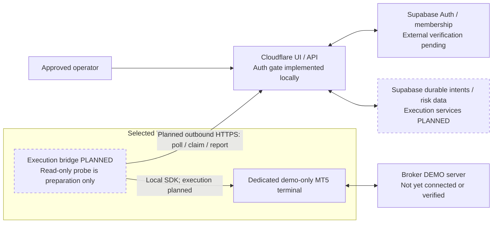

# MT5 demo execution audit and release plan

This continues the completed local authentication repair. The objective is an order sent by this application to a positively verified **MT5 demo account**, followed by broker-side reconciliation. No deployment, remote database change, GitHub push, broker connection or order is authorized by this plan. Each has a separate approval gate below. Live trading remains disabled.

The operator selected a **Windows/VPS native MT5 terminal bridge** as the primary route. Mirro remains an audited, unselected alternative; no provider purchase or hosted account provisioning is requested by that choice.

Read the [authentication repair report](../authentication-repair.md), [Cloudflare release runbook](cloudflare-deployment.md), and [Supabase migration runbook](supabase-migration.md) alongside this document. Their outstanding external checks remain prerequisites. The local directory is still not a Git checkout, so a Git diff/status cannot establish which files have changed remotely.

**Later approved read-only evidence, 28 October 2026:** the installed local terminal and isolated SDK connected to a native **MetaQuotes-Demo** demo account with both terminal trading controls disabled. The operator confirmed **MetaQuotes-Demo is the intended demo server**. Exact **EURUSD** is visible, but quote freshness failed because both raw native epoch fields are approximately two hours ahead of independently checked Unix UTC. A source-conversion audit found no local-time relabeling bug; no offset was applied and freshness limits remain unchanged. The upstream timestamp basis, approved account/symbol binding, full risk inputs and application execution binding remain unverified. This verifies no separate broker's demo account. The separately approved inspection does not authorize deployment, schema changes or orders, and does not implement an execution bridge. See [the complete current status](../mt5-windows-installation.md).

## Present capability and exact blockers

| Area | What exists locally | Missing evidence or implementation |
| --- | --- | --- |
| Authentication | Official Supabase Auth, verified user identity, approved membership, active-session checks, bearer APIs and RLS tests | Actual target schema/policies, owner mapping, invited operator, email recovery and deployed sign-in still require verification |
| Cloudflare | Static frontend and HTTP API; local build/runtime tests | Approved release of the repaired files and verification at the existing deployed origin |
| MT5 adapter | Account/symbol/quote validation and a transport boundary | Verified broker demo identity, current broker account/risk state and complete tradable contract metadata |
| Order submission | `Mt5Adapter.submitOrder()` is blocked | No enabled or released order/close/cancel path, no authenticated execution endpoint, no end-to-end provider order handling |
| Native terminal preparation | Installed terminal/SDK and approved read-only native MetaQuotes demo identity verification; exact EURUSD observed | Quote timestamp basis/freshness, chosen broker/account binding and full risk state remain unverified; the probe is not an execution bridge or dispatcher |
| Alternative provider integration | Historical Mirro connector and server-only configuration names; local contract corrections can be tested with fixtures | Mirro is unselected; no approved account/key/hosting; complete native verification remains absent |
| Intent state machine | An in-memory `ExecutionLedger` and historical execution tables | Durable account-bound reservation, leases/fencing, expected-state transitions, append-only events, recovery and broker reconciliation |
| Trusted proposal/risk pipeline | Deterministic calculations and owner-scoped proposal approval | No active trusted proposal writer; the risk API deliberately supplies no account/instrument/quote/exposure and therefore cannot grant PASS |
| Database permissions | Execution records are owner-readable; browser proposal/intent writes are denied | Reviewed narrow reservation/claim/transition RPCs and machine capabilities; migration 008 must not be weakened to make execution work |
| Supervision | In-memory worker lifecycle and historical lease/recovery tables | No durable dispatch/worker integration, heartbeat/lease persistence, account-wide in-flight protection or reconciler |

The existing configuration **rejects** demo/connector/worker/order enablement. Setting an environment variable is not a release path. A completed build, a paper position, a fixture returning `filled`, an in-memory ledger record or an HTTP provider command receipt does not prove a broker order occurred.

`npm run demo:preflight` is an **offline** configuration/readiness inventory. It may load the ignored local `.env`, prints only presence/blocked-capability evidence, makes no external request, and currently exits **2** because execution is blocked. A present URL/key/account setting means configured only; it does not verify credentials, Supabase, Cloudflare, an MT5 terminal, demo classification, permission to submit or an actual order. No broker connection is started by this command. Do not bypass the blocked result or treat it as a deployment/connection approval.

Own audit/risk rows can currently be inserted through the authenticated Data API. Those records must never become execution authority merely because their payload contains `PASS`; a future execution service must create or revalidate trusted risk from broker-derived inputs.

Local preparation hardens `api/_lib/mt5/reconciliation.js` against missing/empty gates, invalid identities, metadata overwriting state/identity, mutable returned evidence and unsupported broker-state claims. It now requires order/deal identifiers for the relevant accepted/fill states and handles repeated reconciliation safely. These identifiers are evidence requirements inside a local model; a mocked identifier is not an actual broker fill, and the model remains in memory.

The Mirro transport changes correct documented read-only paths/pagination and keep native account verification blocked when the provider supplies only provisioning metadata. The new offline readiness module/CLI reports missing capabilities without exposing secrets or creating connections. The native probe supplies only the local inspection foundation described below. None adds an order API, a durable execution repository, an enabled worker or a remote migration. The Supabase authentication implementation and its safety boundaries are preserved.

## An external execution environment is required

Cloudflare hosts the dashboard, authorization API and orchestration. It does not contain this project's MT5 terminal or an implemented native broker bridge.



The proposed starting design is **outbound polling/claim-report requests from the Windows/VPS bridge to authenticated Cloudflare APIs**. Claim responses return through those bridge-initiated requests; the design does not expose a public localhost terminal URL. Broker login/password credentials remain on the Windows host. The Worker receives only a narrowly scoped bridge credential/capability and validated broker snapshots/results, never the terminal password. Machine authentication, owner/account binding, allowed claim/report operations and durable database RPCs still require explicit capability/schema review. The diagram does not represent an implemented execution bridge, a deployed execution API or an actual broker connection.

The selected native route and the unselected alternative have different hosting requirements:

| Route | External component | Requirements and limitations |
| --- | --- | --- |
| **Selected: native MetaQuotes integration** | Installed MT5 terminal plus a supervised Python/EA execution bridge on the approved Windows machine/VPS | The terminal must be installed, connected and authenticated separately from Cloudflare. The read-only probe is only a preparation tool. Secure Cloudflare-to-host communication, terminal supervision, durable intent processing, submission and reconciliation are still missing. A localhost terminal cannot be reached from Cloudflare merely by setting a URL. |
| Unselected alternative: hosted provider such as MirroAPI | Provider-managed MT5 terminal | A local terminal is not required when that service hosts the account. Provider signup, hosting/account provisioning and billing require separate approval if this alternative is reconsidered. Contract, server/account support, permissions and native demo classification must be verified first. No paid commitment is recommended or authorized here. |

The [Mirro quickstart](https://mirroapi.com/docs/quickstart/) and [official OpenAPI contract](https://mirroapi.com/docs/openapi.yaml), reviewed during this audit on 28 October 2026, describe its externally hosted terminal/API. Native integration must follow the [MetaQuotes terminal initialization reference](https://www.mql5.com/en/docs/python_metatrader5/mt5initialize_py) and [account information/trade-mode constants](https://www.mql5.com/en/docs/constants/environment_state/accountinformation). Confirm current operating-system/package support before choosing a terminal host. An EA using HTTPS also requires the deliberate [WebRequest URL allowlist configuration](https://www.mql5.com/en/docs/network/webrequest).

### Unselected Mirro alternative: audited contract gaps

The documented API separates account metadata (`GET /accounts/{id}`), financial account information (`/information`), symbol specification (`/specification`), price (`/price`), positions, orders and deal history. The expected base includes `/v1`. Deal history is paginated using `items` and `nextCursor`; complete pagination is required for reconciliation and daily loss/exposure calculations.

The documented account `environment` is a provisioning input. It is not evidence of the connected terminal's native `ACCOUNT_TRADE_MODE_DEMO`. Account names or a server name containing “demo” are also insufficient. Obtain a trustworthy broker/terminal-derived account trade mode and verify the exact login/server before arming anything.

The current documented symbol catalog leaves `tickSize` and `tickValue` null, and does not supply every point, filling-policy and stop-distance field needed by this application. Do not invent tick value, profit currency, allowed filling policies, stop/freeze distances or a risk currency conversion. Resolve these omissions through a verified provider contract or trusted terminal bridge; otherwise execution remains blocked.

### Risk inputs still missing on the selected native route

The adapter and risk-engine data shapes are also not yet connected. The risk engine consumes `quote.price` and `spreadPips`, while the adapter exposes bid/ask and a raw price spread. A trusted conversion must select the executable BUY ask or SELL bid and convert the spread into verified pip units; silently using a missing spread as zero is unacceptable for execution. Strategy symbols such as `EUR/USD` also need an explicit reviewed mapping to exact broker symbols such as `EURUSD` or a broker-specific suffix.

Account state is missing the trusted `dailyStartEquity`, `tradingDayKey`, `lossToday` and currency conversion inputs required by risk evaluation. Exposure requires `openPositions`, `lossStreak`, `coolingUntil` and aggregate exposure in defined units. The sizing interface expects reviewed `pipSize`, `pipValuePerLot`, base/quote currency and volume field mappings. Its current infinity default is rejected by its finite-value validator: configure a verified **finite** aggregate exposure limit rather than weakening or bypassing the limit. These mapping/currency/cost calculations require independent validation against broker profit/margin results before the first order; no risk formula is changed speculatively in this preparation.

### Unselected Mirro alternative: commands and credentials

A future asynchronous order request returning **202** means a command was accepted for processing. It must be polled and reconciled with actual broker order/deal/position identifiers and final broker result. An unknown outcome after a timeout must block resubmission until reconciliation establishes what occurred. Provider keys or naming prefixes must not be used as proof of the broker account's demo status.

The documented credential header is `Authorization: Bearer <key>` with base `https://api.mirroapi.cloud/v1`. Start any approved external inspection with the provider's Test/read-only token configuration restricted to the intended account. Account onboarding needs a separately approved provisioning capability; an eventual execution runtime key should be account-restricted Test `read`/`trade` only, without provisioning permission. Separately, account metadata must report `roles.follower === true` and `executionCertified === true` under the current provider contract; `master` may also be true. Those are provider account requirements, not API-key scopes and not proof of native demo classification. The provider's [error contract](https://mirroapi.com/docs/errors/#EXECUTION_ROLE_REQUIRED) must drive safe handling of asynchronous/unknown results; do not use automatic mutation retries as recovery.

## Required account details and credential handling

The operator must identify these nonsecret connection details through the chosen broker/provider: broker/company, exact demo login, exact server, account currency, intended broker symbol including any suffix, and provider account ID if applicable. Confirm hedging versus netting mode, account permissions, leverage/margin model, market session and any broker demo restrictions through trusted account information. Do not infer these from dashboard placeholder text or paper simulation state.

Passwords, provider keys, service tokens and recovery links belong only in approved secure stores. Never paste them into chat, commit them, return them through an API, put them in browser JavaScript or write them into reports. A read-only/investor credential may suffice for account inspection where supported; placing an order needs the broker's trading permission, which must be approved separately. Do not broaden credentials early just to get a readiness indicator to turn green.

## Exact configuration: current release versus future demo release

These are the **current supported** authentication-release settings. Keep them in effect during all local preparation and until a separately reviewed implementation and explicit approval authorize a change:

| Name | Classification | Current value/purpose |
| --- | --- | --- |
| `APP_ENV` | Public runtime variable | `production` for the approved Cloudflare release; `development` for local testing |
| `APP_ORIGIN` | Public runtime variable | `https://yosemite-ai-trading-bot.francismkanda01.workers.dev` in production; exact local origin for local testing |
| `SUPABASE_URL` | Public runtime variable | `https://txdjozotaxpthpnfikqx.supabase.co` |
| `SUPABASE_PUBLISHABLE_KEY` or `SUPABASE_ANON_KEY` | Public project key; the existing encrypted alias may be retained | Key from the same project; no privileged Supabase key is needed for current user APIs |
| `TRADING_MODE` | Public safety variable | `disabled` |
| `LIVE_TRADING_ENABLED` | Public safety variable | `false`, including every future demo release |
| `WORKER_ENABLED` | Public safety variable | `false`; this refers to execution jobs, not Cloudflare HTTP request serving |
| `MT5_EXECUTION_ENABLED` | Public safety variable | `false` |
| `MT5_DEMO_MODE` | Public safety variable | `false` |
| `MT5_CONNECTOR` | Public safety variable | `none` |
| `.node-version` / optional build `NODE_VERSION` | Public build setting | Tested Node 24.22.1; Node 22+ required by pinned Wrangler 4.154.0 |

The repository currently recognizes the following **alternative-provider connection names**, but they do not activate a connection or an order path under the current safety configuration. Mirro is not selected for the primary release:

| Name | Classification | Required evidence before eventual use |
| --- | --- | --- |
| `MT5_ALLOWED_ACCOUNT_LOGINS` | Server-managed identity allowlist | Exactly the independently verified demo login(s); no browser-supplied account selection |
| `MT5_ALLOWED_SERVERS` | Server-managed identity allowlist | Exact terminal-reported server(s), including case; validate supported configuration syntax |
| `MIRRO_ACCOUNT_ID` | Server-only account routing identifier | Approved hosted account bound to the same verified demo login/server |
| `MIRRO_API_KEY` | Encrypted server-only secret | Provider-documented restricted/account-scoped key, initially read-only where supported; trade scope only after separate approval |
| `MIRRO_API_BASE_URL` | Server-managed HTTPS origin/base | Verified provider contract; current candidate `https://api.mirroapi.cloud/v1`; no caller-supplied endpoint |
| `MIRRO_TIMEOUT_MS` | Public runtime limit | Current default `10000`; timing out an eventual mutation must create an unknown outcome rather than a blind retry |

These Mirro names are not a runnable activation recipe. Native-host **probe** configuration is listed below; a native **execution transport** is still unimplemented. Its host endpoint, machine identity, request authentication, secret rotation, account/symbol binding and terminal credential lifecycle need explicit design. Do not substitute the commented historical `MT5_API_URL` or an arbitrary URL and assume it works.

The existing `RISK_*` settings remain risk ceilings to enforce, not permission to execute. First-order size must come from the verified contract, actual account currency, allowed risk and explicit order approval. Do not assume that `0.01` lots is supported or acceptable for the selected account/instrument.

## Selected native terminal: read-only probe and exact configuration

`bridge/mt5_demo_probe.py` is a standalone **read-only probe**, not an execution bridge, HTTP listener, queue consumer or order dispatcher. Its default CLI mode is an offline configuration check and does not import the MetaTrader5 SDK or connect to a terminal. The opt-in connection flag must not be used until the operator approves the specific terminal path, demo account and read-only connection action.

| Native-host setting | Classification | Required value/meaning |
| --- | --- | --- |
| `MT5_TERMINAL_PATH` | Operator-approved local executable path | Exact installed MT5 terminal executable on the selected Windows machine/VPS; do not auto-discover or reuse a last-used terminal |
| `MT5_LOGIN` | Server-managed account identity | Exact intended demo login, explicitly supplied and present in the login allowlist |
| `MT5_PASSWORD` | Secret on the terminal host only | Approved account credential from a secure host store; never put it in source, CLI arguments, Cloudflare public variables, browser code or reports |
| `MT5_SERVER` | Server-managed account identity | Exact intended broker server, explicitly supplied and present in the server allowlist |
| `MT5_SYMBOL` | Reviewed broker symbol | Exact broker symbol including any suffix; it is not an order request or strategy-symbol mapping |
| `MT5_ALLOWED_ACCOUNT_LOGINS` | Server-managed identity allowlist | Must include the exact explicitly supplied `MT5_LOGIN` |
| `MT5_ALLOWED_SERVERS` | Server-managed identity allowlist | Must include the exact explicitly supplied `MT5_SERVER` |

These are native-host probe settings, not new Worker bindings. They do not change the application's disabled trading configuration. Before any approved connection, record the actual terminal installation/path and the host's Python/SDK compatibility, including supported Windows/Python architecture and the installed official MetaTrader5 package version. SDK or terminal installation is a separate setup action; neither is performed by the offline probe or this preparation. Never invoke an implicit SDK initialization that silently attaches to whichever account was last logged in.

**Before any native connection, use a dedicated demo-only terminal/data profile. Never reuse a live account profile.** Initialization may launch the terminal and its existing automation, so first verify that no autonomous EA, copy-trading service or Signals subscription can act, and keep terminal **Algo Trading disabled** throughout read-only inspection. The probe reports permissions; it does not enable them or disable preexisting third-party automation for you. Approval to use `--connect-read-only` authorizes only that inspection, never an order, permission change or terminal automation.

Safe offline invocation:

```text
python bridge/mt5_demo_probe.py
```

**Future connection command, only after explicit read-only connection approval and verified host setup:**

```text
python bridge/mt5_demo_probe.py --connect-read-only
```

The latter may start/connect the approved local terminal and authenticate the explicit account. It is an actual connection action, not an offline test. The probe must positively verify native demo trade mode, exact allowlisted login/server and terminal connection, and return only a whitelisted read-only snapshot. It contains no `order_check`, `order_send`, close or cancel action. A successful probe does not create the missing risk history, durable execution infrastructure or permission to submit an order; it must continue reporting `executionAllowed=false` and `actualBrokerOrderExecuted=false`.

The future execution bridge still needs a reviewed authenticated HTTPS or outbound-polling transport between Cloudflare and this host, narrow machine authorization, durable intent claiming/leases, broker preflight/submission and reconciliation. A JSON probe report copied into a file is not that bridge and must not be presented as end-to-end trading integration. Never accept browser-uploaded probe JSON, user IDs or role claims as trusted broker evidence or execution authority.

## Durable execution design required before arming

Prepare this locally first, then review the exact schema/RPC and access changes before remote application:

1. Bind an operator's preserved domain identity to one approved broker/provider account, exact login/server and positively verified demo classification. Store the verification source, server capture time, expiry and contract/schema version. Refuse real, contest, unknown, stale, mismatched or changed accounts.
2. Create trusted proposal/risk snapshots on the server from fresh broker account equity/free margin, positions, pending orders, fills/loss history, exact symbol contract and current bid/ask. Require complete history/pagination, explicit trading-day boundaries, commission/conversion data and freshness limits. AI/advisory output does not authorize an order.
3. Persist an immutable approved proposal bound to owner, account, symbol, direction, quantity, entry constraints, stop-loss, take-profit, digest/version, risk configuration and expiry. Revalidate risk immediately before submission. Approval of one proposal must not authorize another account or changed parameters.
4. Use a narrowly scoped reservation RPC that derives owner from verified Supabase identity, locks/checks the approved proposal and current account, enforces one intended submission, inserts a durable intent/outbox record and records the approval atomically. Browser clients must have no general INSERT/UPDATE access to proposals or execution state.
5. Give the execution process only the reviewed capability to claim an intent, renew its lease and append an allowed transition. Claims require fencing/expected-state checks. Bind idempotency to the exact immutable intent and account; do not rely on isolate memory or merely sending a header to a provider.
6. Persist `submission_initiated` before the external mutation. Map provider command IDs and broker order/deal IDs separately. Enforce legal transitions in the database, not only in an in-memory JavaScript class. Record partial fills and position effects according to hedging/netting mode.
7. If acknowledgement is lost, persist `submission_unknown`/`reconciliation_required`, block duplicate dispatch, and inspect broker command/order/deal history using the original identifiers. A missing record in one incomplete page is not proof that resubmission is safe. Do not promise exactly-once broker execution without a verified broker/provider idempotency mechanism.
8. Use server-only restricted provider credentials and a separate narrow machine capability for any bridge. Keep operator authentication on Supabase. Do not expose a service-role key or weaken existing RLS to bypass missing execution permissions. Review any privileged function/view, access grant and machine identity separately.
9. Enforce account-wide limits, a kill switch, bounded queue/lease/recovery behavior, one-order canary limits and alerts. A worker restart or expired operator session must not create a second order. Define how pending intents are stopped when membership or approval is revoked.

The historical `execution_intents`/`execution_transitions` schema does not yet provide these guarantees. In particular, it lacks complete broker-account binding and a database-enforced transition/reservation API. No remote execution migration is applied by this work.

## Release sequence and separate approvals

1. **Preserve the authentication baseline locally.** Run the full auth/RLS suite and local Worker/browser checks, then `npm run demo:preflight` for the offline inventory (expected exit 2 while blocked). Review actual changed files. Keep all execution flags disabled. Resolve any regression before further release preparation.
2. **Inspect Supabase read-only.** In the existing `Yosemite_Ai_Bot` project, run the documented metadata preflight, inventory actual tables/views/functions/grants/policies, migration ledger, domain ownership and Auth users. Do not assume the remote schema matches local migrations or is empty.
3. **Approve exact database changes.** Review the backup/recovery plan, missing auth DDL and owner mapping. Obtain explicit approval before any remote mapping, policy/grant or schema modification. Apply only reviewed SQL. Future execution schema/capability changes require their own review; do not blindly replay migrations.
4. **Verify the authorized operator.** Keep unrestricted signup disabled; invite the intended owner and map that Auth UID to its existing domain owner. Verify correct/incorrect login, refresh, recovery, membership denial, cross-user RLS and immediate access-token denial after logout in the actual project. Current Supabase URL/public key/origin must match on browser and Worker.
5. **Approve and release authentication to Cloudflare.** Confirm the existing Worker, exact origin, preserved public/secret binding classification and Node version. Obtain explicit deployment approval. If GitHub upload triggers production builds, obtain GitHub/deployment approval before that upload too. Do not combine an auth release with first-order enablement.
6. **Prepare the selected Windows/VPS native route.** Confirm the intended broker/demo account and the specific approved host/terminal executable. Use a dedicated demo-only terminal/data profile with no autonomous EA/copy-trading/Signals activity and Algo Trading disabled; never reuse a live profile. Record supported Python/SDK versions and review any required installation separately. Obtain exact nonsecret account/server/symbol details and place the account password only in the host's secure store. Run the native probe's offline mode and its mocked unit tests. Do not purchase/provision Mirro or another service; reconsidering that alternative would need a separate choice and approval.
7. **Approve a read-only account connection.** Obtain explicit approval for the named host, terminal path, isolated demo profile and demo account, then use the native probe's explicit connection option. This does not authorize changing Algo Trading or starting automation. Positively verify native demo classification and exact identity, terminal connection/permission state, equity/margin, fresh quote and full symbol specifications. Execution also needs complete positions/orders/loss history and risk inputs beyond this probe's limited snapshot; missing inputs remain blockers. Reject real/contest/unknown/mismatched/stale accounts or metadata. This phase must not call order/close/cancel endpoints.
8. **Complete durable execution and fault tests locally.** Test concurrent duplicate requests, Worker/bridge restarts, lost acknowledgement, partial fills, stale/changed account state, invalid stop/filling/volume/margin constraints, session/membership revocation and kill-switch behavior. Use isolated PostgreSQL and mocked broker transport; label them as such.
9. **Approve execution schema and deployment separately.** Review the exact new SQL/RPC/grants, server-only machine capability, outbound bridge contract, immutable order approval and emergency stop/cleanup path. Apply/deploy only after the corresponding explicit approvals. Keep live trading disabled. Readiness evidence must be fresh again immediately before the canary.
10. **Approve one specific first demo order.** Present the exact verified account/login/server, symbol, side, calculated broker-valid volume, stop-loss/take-profit, maximum spread/slippage, expiry, proposal digest and current risk/margin result for explicit approval. A broker [order_check](https://www.mql5.com/en/docs/python_metatrader5/mt5ordercheck_py) or equivalent preflight is a prerequisite where supported; success is not a promise of execution. A native [order_send](https://www.mql5.com/en/docs/python_metatrader5/mt5ordersend_py) call is an actual external mutation requiring that specific approval. No order is submitted by the current local preparation.
11. **Submit and reconcile only the approved intent.** Persist/claim it once, rerun final identity/risk/permission checks and send through the approved bridge. Distinguish command receipt, broker acknowledgement, acceptance, partial fill and fill. On ambiguity, stop and reconcile; never press “retry” to manufacture a second trade.
12. **Verify broker evidence and clean up under approval.** Confirm the order/deal/position in the actual MT5 terminal or trusted broker history, linked to the same intent/account. Record broker timestamps, ticket IDs, executed volume/price, protection levels and final state without credentials. Obtain explicit approval for any close/cancel operation unless that precise cleanup was already included in the first-order approval. Confirm final positions/pending orders and disable further submissions before considering a wider demo run.

## Verification record and remaining decisions

Current-turn verification completed as follows:

| Check | Actual result | Evidence scope |
| --- | --- | --- |
| Existing baseline `npm run verify` | 138 passed, 0 failures/skips | Authentication repair and unrelated existing application tests |
| Final `npm run verify` | **160 passed, 0 failures/skips** | JavaScript syntax, auth/API/RLS regression tests, ledger and read-only transport tests, offline preflight |
| `python -m unittest discover -s tests -p mt5_demo_probe_test.py -v` | **14 passed** | Injected synthetic SDK only; final parent pass used Python 3.12.14 |
| `npm run worker:build` | Passed | Local Wrangler dry-run packaging, no deployment |
| `npm run test:worker-runtime` | Passed | Isolated local Workerd, synthetic config, protected-route denial and static security |
| `npm run demo:preflight` | Expected exit 2, blocked | Offline inventory only; local Supabase/native fields absent, no external verification |
| `python bridge/mt5_demo_probe.py` | Expected exit 2, blocked; `connectionAttempted=false` | Actual offline CLI only; no SDK import or terminal initialization |
| Core authentication/database source integrity | Eight baseline files compared; no byte changes | Includes Supabase identity/session handlers, Data API client, browser auth controller and migration 008 |

Final JavaScript/build commands used the existing verified Node 24.22.1 runtime. The previous authentication repair also recorded six mocked-network browser tests; those were not rerun in this phase because no browser authentication code changed. No MetaTrader5 SDK was installed, no `--connect-read-only` command was run, and no real terminal/broker connection or order occurred. These results do not prove external Supabase configuration, a connected terminal, broker preflight or a demo fill.

Changed local areas are `api/_lib/mt5/reconciliation.js`, `api/_lib/mt5/mirro.js`, the new `api/_lib/mt5/demo-preflight.js` and `scripts/demo-preflight.mjs`, `bridge/mt5_demo_probe.py` and its README, the related JavaScript/Python tests, package scripts, README and this release plan. Authentication source, existing SQL migrations and the deployed resources were preserved. The state-machine gate fixes do not turn its caller-supplied booleans or private in-memory Map into a durable authorization/dispatch service.

The local configuration inventory found no Supabase/Mirro keys, MT5 account/server allowlists or terminal password settings. Values were not printed. The prior read-only Cloudflare evidence identifies the existing Worker/origin/binding names; it has not been refreshed or changed in this turn. Actual target Supabase schema, Auth/dashboard state and broker account state remain unverified.

Remaining external blockers include actual Supabase verification and approved owner/schema changes; deployment of the repaired authentication; setup/verification of the selected Windows/VPS host and exact MT5 terminal; actual demo account identity and credentials; approved read-only native connection; trustworthy native demo classification; complete risk/contract data; durable execution/proposal/lease/reconciliation capabilities; authenticated Cloudflare-to-host communication; explicit release approvals; and approval of a specific first demo order plus its cleanup. The bridge route is selected, but an execution bridge has not yet been built or connected.

No real or demo broker execution has been performed by this audit. A readiness report must distinguish **configured**, **locally tested**, **externally verified**, **approved** and **broker executed** as separate evidence states. It must remain blocked when any required evidence is unavailable or stale.
